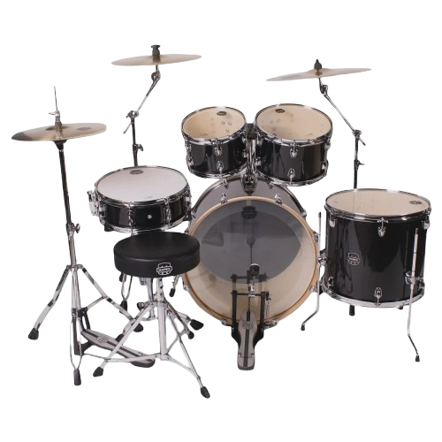

# The Rock Kit — Interactive Drum Experience & Studio

An interactive drum experience and rhythm studio built with React 19, TypeScript, Vite, and the Web Audio API.



---

## 🥁 Features & Architecture

### 1. Interactive Real Drum Kit (Hero Section)
- **High-Fidelity Visual Cutout & Floating Drum Motion**: Custom-tuned drum kit with physics-based 3D tilt, bounce, and strike recoil animations.
- **Web Audio Engine**: Realistic acoustic drum synthesis with zero-latency transient shaping, snare wire buzz, bass sub-thump, and cymbal shimmer.
- **Dynamic Floating Title & Concert Atmosphere**: Glowing animated typography with continuous floating motion and shimmering stage ambiance.
- **Responsive Navigation & Keyboard Bindings**: Play along using keyboard shortcuts (`B` for Kick, `S` for Snare, `H` for Hi-Hat, `F` for Floor Tom, `C` for Crash, `R` for Ride).

### 2. Acoustic Physics & Shell Anatomy
- **Interactive Component Explorer**: Inspect the acoustic craftsmanship, shell ply construction, and tuning advice for every piece of the kit.
- **Live FFT Spectrum Visualizer**: Real-time canvas frequency visualizer displaying harmonic transients upon every drum hit.
- **Acoustic Blueprint & Resonance Atmosphere**: Dynamic CAD blueprint background with caliper arcs and acoustic resonance waves responding to drum strikes.

### 3. Cinematic Rudiments Masterclass
- **Motion Graphic Breakdown**: 46-second synchronized motion graphic video dissecting the 5 foundational rudiments: Single Stroke, Double Stroke, Paradiddle, Flam, and Drag.
- **Interactive Chapter Seeking**: Jump straight to any rudiment timestamp with real-time HUD telemetry and active chapter badges.
- **Cinema Theater Ambiance**: Volumetric projector beam, anamorphic blue light flares, and floating film motes responding to video playback.

### 4. FreeMusic Studio (16-Step Beat Machine)
- **16-Step Sequencer**: Program beats with Kick, Snare, Hi-Hat, and Clap channels with variable BPM tempo control.
- **Dynamic Performance Drum & Synth Pads**: Real-time triggerable MPC-style drum pads and polyphonic melodic synth pads.
- **Rhythm LED Matrix**: Downbeat quarter-note bass aura pulses and LED rhythm tracks reacting to the sequencer clock.

---

## 🚀 Quick Start

### Prerequisites
- Node.js 18+
- npm or pnpm

### Installation
```bash
# Clone the repository
git clone https://github.com/<username>/<repo-name>.git
cd <repo-name>

# Install dependencies
npm install

# Start local development server
npm run dev
```

### Production Build
```bash
npm run build
npm run preview
```

---

## 🌐 Deployment

### Netlify
This repository includes a pre-configured `netlify.toml`:
```toml
[build]
  command = "npm run build"
  publish = "dist"

[[redirects]]
  from = "/*"
  to = "/index.html"
  status = 200
```
Simply connect your GitHub repository to [Netlify](https://www.netlify.com/), and it will deploy automatically on push.
